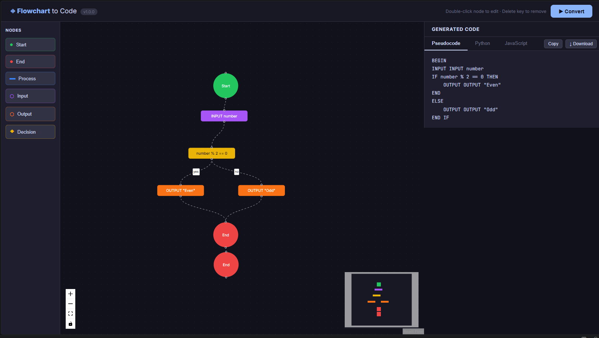

# Flowchart-to-Code Converter

A full-stack educational tool that converts visual flowcharts into
**Pseudocode**, **Python**, and **JavaScript** simultaneously.

Start with the [classroom lesson and language comparison](docs/LESSON.md).
Runnable Python, browser JavaScript, and matching pseudocode are in `examples/`.
The [Word test evidence report](docs/Test%20Evidence.docx) includes screenshots
of actual verbose test results and build output. Original images and transcripts
are preserved in `docs/test-evidence/`.

---

## Features

| Feature | Details |
|---|---|
| Visual editor | Drag-and-drop canvas (React Flow) |
| Node types | Start, End, Process, Input, Output, Decision |
| Code generation | Pseudocode · Python 3 · JavaScript (ES2020) |
| Validation | Structural checks before generation |
| Export | Copy to clipboard · Download as file |
| Architecture | Modular IR pipeline — easy to add more languages |

---

## Tech Stack

| Layer | Technology |
|---|---|
| Frontend | React 18 · TypeScript · React Flow · Vite + SWC |
| Backend | Node.js · Express · TypeScript |
| Testing | Jest (backend) · Vitest (frontend) |

---

## Getting Started

### Prerequisites

- **Node.js** >= 18
- **npm** >= 9

### Installation

```bash
# Clone the repository
git clone https://github.com/luigi043/demo3-flowchart-to-code.git
cd demo3-flowchart-to-code

# Install backend dependencies
cd backend
npm install
cd ..

# Install frontend dependencies
cd frontend
npm install
cd ..
```

### Running in development

Open two terminals:

```bash
# Terminal 1 - Backend (port 3001)
cd backend
npm run dev

# Terminal 2 - Frontend (port 5173)
cd frontend
npm run dev
```

Open **http://localhost:5173** in your browser.

---

## Usage

1. **Add nodes** - click any button in the left sidebar
2. **Connect nodes** - drag from the handle on one node to another
3. **Edit labels** - double-click any node
4. **Delete nodes** - select a node, press Delete key
5. **Convert** - click the Convert button in the header
6. **View output** - switch tabs (Pseudocode / Python / JavaScript)
7. **Export** - click Copy or Download

---

## API Reference

### POST /api/convert

**Request body**

```json
{
  "flowchart": {
    "nodes": [
      { "id": "1", "type": "start",    "label": "Start" },
      { "id": "2", "type": "input",    "label": "number" },
      { "id": "3", "type": "decision", "label": "number % 2 == 0" },
      { "id": "4", "type": "output",   "label": "\"Even\"" },
      { "id": "5", "type": "output",   "label": "\"Odd\""  },
      { "id": "6", "type": "end",      "label": "End" }
    ],
    "edges": [
      { "id": "e1", "source": "1", "target": "2" },
      { "id": "e2", "source": "2", "target": "3" },
      { "id": "e3", "source": "3", "target": "4", "label": "yes" },
      { "id": "e4", "source": "3", "target": "5", "label": "no"  },
      { "id": "e5", "source": "4", "target": "6" },
      { "id": "e6", "source": "5", "target": "6" }
    ]
  }
}
```

**Success response (200)**

```json
{
  "success": true,
  "result": {
    "pseudocode": "BEGIN\n    INPUT number\n...",
    "python": "number = float(input(\"Enter number: \"))\n...",
    "javascript": "let number = Number(prompt(\"Enter number: \"));\n..."
  }
}
```

---

## Architecture

```
User
 |
 v
React Flow Editor  ──────────────────────> React State (Flowchart)
                                                    |
                                            POST /api/convert
                                                    |
                                                    v
                                           FlowchartValidator
                                                    |
                                                    v
                                              IRBuilder
                                       (graph -> flat IR list)
                                                    |
                              +---------------------+--------------------+
                              v                     v                    v
                   PseudocodeGenerator    PythonGenerator    JavaScriptGenerator
                                                    |
                                           GenerationResult
                                                    |
                                                    v
                                          OutputPanel (frontend)
```

---

## Running Tests

```bash
cd backend
npm test
```

Run `npm run build` in both `backend` and `frontend` for production checks.
Backend tests execute generated JavaScript and check invalid graphs and branch
merges. Set `PYTHON` to a Python 3 executable to also execute generated Python.

---

## Project Structure

```
flowchart-to-code-converter/
├── backend/
│   ├── src/
│   │   ├── index.ts
│   │   ├── models/types.ts
│   │   ├── routes/convert.ts
│   │   ├── services/
│   │   │   ├── conversionService.ts
│   │   │   └── irBuilder.ts
│   │   ├── validators/flowchartValidator.ts
│   │   └── generators/
│   │       ├── pseudocode/
│   │       ├── python/
│   │       └── javascript/
│   └── tests/pipeline.test.ts
│
├── frontend/
│   ├── index.html
│   ├── vite.config.ts
│   └── src/
│       ├── App.tsx
│       ├── main.tsx
│       ├── types/
│       ├── services/
│       ├── hooks/
│       └── components/
│           ├── FlowEditor/
│           ├── NodePanel/
│           ├── OutputPanel/
│           └── LanguageTabs/
│
├── docs/ARCHITECTURE.md
├── examples/even-odd.json
└── README.md
```

---

## Extending - Adding a New Language

1. Create `backend/src/generators/<lang>/<lang>Generator.ts`
2. Implement `generate<Lang>(ir: IR): string`
3. Import and call it in `conversionService.ts`
4. Add a new tab in `LanguageTabs.tsx`

---

## Future Improvements

- Loop support (while / for nodes in IR)
- AI-assisted flowchart generation from plain text
- Reverse conversion: paste code, get flowchart
- Java, C#, Kotlin generators
- PDF export of full flowchart + code report

---

## License

MIT
