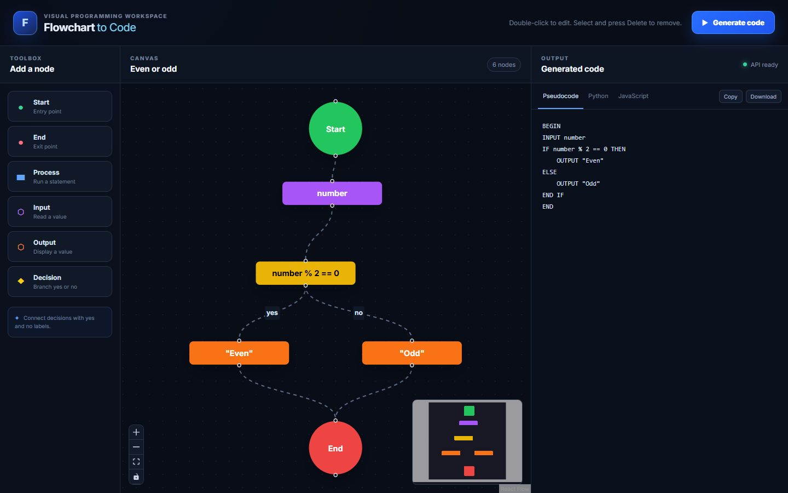
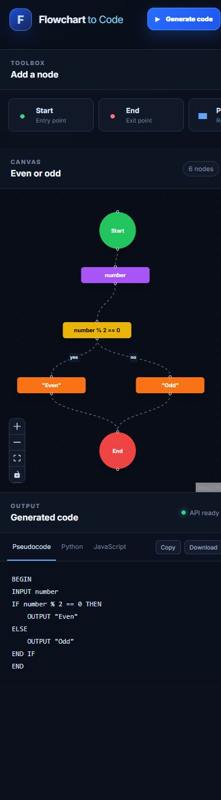

# Flowchart to Code

A full-stack visual programming workspace that validates a flowchart and
generates equivalent pseudocode, Python, and JavaScript. The project is built
as an educational tool and as a demonstration of graph traversal, intermediate
representations, API design, and responsive React UI engineering.



## Why this project exists

Beginning programmers often understand a process visually before they are
comfortable expressing it as syntax. Flowchart to Code keeps those concerns
separate: users describe control flow on a canvas, while the conversion
pipeline validates the graph and renders the same intermediate representation
into three output languages.

## Highlights

- Interactive React Flow canvas with editable and connectable nodes
- Structural validation for start/end nodes, branches, references, reachability, and cycles
- Shared intermediate representation instead of language-specific graph traversal
- Simultaneous pseudocode, Python 3, and JavaScript output
- Copy and file-download actions for every generated result
- Responsive desktop and mobile layouts with keyboard and reduced-motion support
- Automated backend, frontend contract, and production-build checks

## Responsive interface

The desktop layout keeps the toolbox, graph, and output visible together. On
smaller screens, the toolbox becomes horizontally scrollable and the canvas and
code output stack vertically.



## Architecture

```text
React Flow canvas
       |
       | POST /api/convert
       v
Runtime payload validation
       |
       v
Structural graph validation
       |
       v
IRBuilder (graph -> ordered statements)
       |
       +----------+-----------+
       v          v           v
  Pseudocode    Python    JavaScript
```

The generators never traverse the visual graph directly. They consume a small,
language-neutral IR containing statements such as `INPUT`, `IF`, `ELSE`, and
`END_IF`. This keeps validation and traversal logic centralized and makes a new
generator an isolated change.

See [Architecture](docs/ARCHITECTURE.md) and the [portfolio case study](docs/CASE_STUDY.md)
for design decisions, trade-offs, and supported graph shapes.

## Tech stack

| Area | Technology |
|---|---|
| Frontend | React 18, TypeScript, React Flow, Vite |
| Backend | Node.js, Express, TypeScript |
| Tests | Jest, ts-jest, Vitest |
| Automation | GitHub Actions |

## Quick start

### Requirements

- Node.js 18 or newer. CI uses Node.js 20.
- npm 9 or newer

```bash
git clone https://github.com/luigi043/demo3-flowchart-to-code.git
cd demo3-flowchart-to-code
npm run install:all
```

Start the backend and frontend in separate terminals:

```bash
npm run dev:backend
```

```bash
npm run dev:frontend
```

Open `http://localhost:5173`. The Vite server proxies `/api` to the backend on
`http://localhost:3001` by default. Copy `frontend/.env.example` to
`frontend/.env.local` only when a different local API target is required.

## Using the editor

1. Add nodes from the toolbox or use the included even-or-odd example.
2. Drag from one handle to another to connect nodes.
3. Double-click a node to edit its label.
4. Label decision edges `yes` and `no`.
5. Select a node and press Delete or Backspace to remove it and its edges.
6. Select **Generate code**, then switch between output languages.

Input labels can be a variable name such as `number`, or a prompt mapping such
as `Enter a number -> number`. Process and condition labels are emitted as code,
so users remain responsible for valid target-language expressions.

## API

### `POST /api/convert`

```json
{
  "flowchart": {
    "nodes": [
      { "id": "1", "type": "start", "label": "Start" },
      { "id": "2", "type": "end", "label": "End" }
    ],
    "edges": [
      { "id": "e1", "source": "1", "target": "2" }
    ]
  }
}
```

Responses use:

- `200` for successful generation
- `400` for a malformed request shape
- `422` for a well-formed flowchart that violates structural rules

`GET /health` returns `{ "status": "ok" }` for service health checks.

## Quality checks

Run every check from the repository root:

```bash
npm test
npm run build
```

Current coverage focuses on the contracts most likely to fail: malformed API
payloads, graph validation, decision-branch merge ordering, generator output,
and preservation of structured frontend errors.

## Project structure

```text
backend/                 Express API, validation, IR, generators, Jest tests
frontend/                React application, responsive UI, Vitest tests
examples/even-odd.json   Example API payload
docs/ARCHITECTURE.md     Technical design and validation rules
docs/CASE_STUDY.md       Portfolio-oriented engineering narrative
docs/screenshots/        Verified captures from the running application
.github/workflows/       Continuous integration checks
```

## Current scope

The converter supports linear flows and acyclic `if/else` branches that rejoin.
Loops are rejected explicitly because the current IR has no loop statements.
Nested or irreducible control-flow graphs are not advertised as supported.

Potential next steps include loop IR statements, language-aware expression
parsing, import/export of editable flowcharts, and additional generators.

## Contributing and license

See [CONTRIBUTING.md](CONTRIBUTING.md) before opening a change. This project is
available under the [MIT License](LICENSE).
