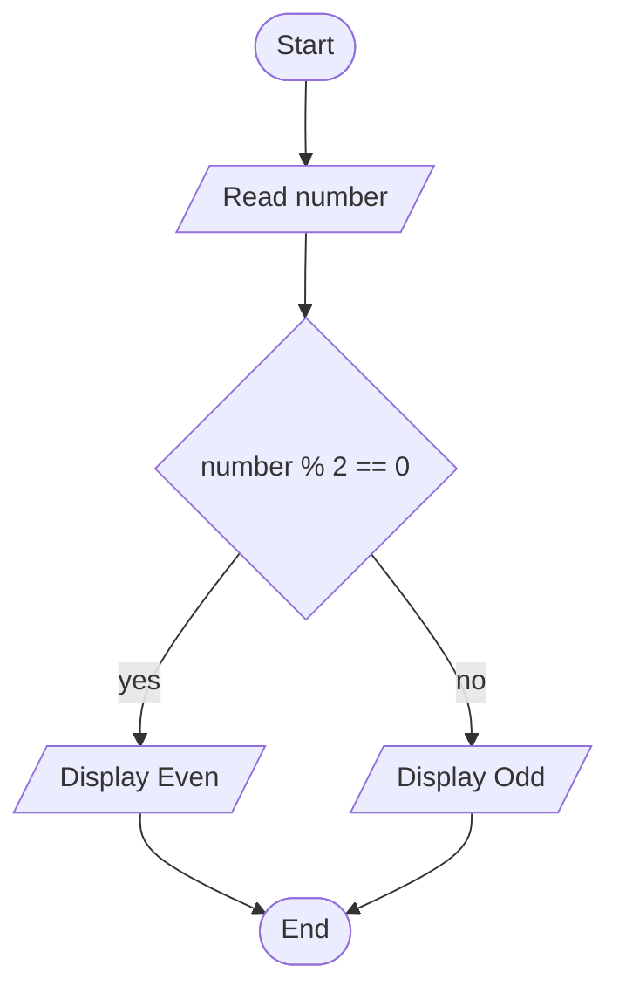

# From flowchart to working code

Open the app and click **Convert** to translate the starter even/odd algorithm.
The three output tabs describe the same sequence and decision.

## Symbol key

| Symbol | Meaning | Starter example |
|---|---|---|
| Oval / rounded terminator | Start or end | Start, End |
| Parallelogram | Input or output | Read number, display Even/Odd |
| Rectangle | Processing / assignment | `x = 10` |
| Diamond | Boolean decision | `number % 2 == 0` |
| Arrow | Direction of execution | Follow yes or no, then rejoin |

## Compare the representations

| Concept | Pseudocode | Python 3 | Browser JavaScript |
|---|---|---|---|
| Numeric input | INPUT number | float(input(...)) | Number(prompt(...)) |
| Remainder | number % 2 | number % 2 | number % 2 |
| Equality | == | == | == (numeric operands here) |
| Decision | IF / ELSE / END IF | if / else, indentation | if / else, braces |
| Output | OUTPUT | print(...) | console.log(...) |
| End | END | End of file | End of script |

The `.txt`, `.py`, and `.js` files in `examples/` are generated from
`even-odd.json`. Run Python with `python examples/even-odd.py`.
Paste the JavaScript into a browser developer console; `prompt` is a browser
API and is not built into Node.js. Output appears in the console.
Try 8 → Even, 7 → Odd, 0 → Even, and -4 → Even. Use integer input for this lesson.

## Editor exercise

1. Double-click a node to edit its label. Input labels are variable names such
   as `number`, optionally `Enter a number -> number`. Output literals need
   quotes, for example `"Even"`. Do not include INPUT/OUTPUT in labels.
2. Add an output labelled `"Done"` between both branch outputs and End.
3. Reconnect both branches to it, then connect it to End. Select obsolete edges
   and press Delete. Double-click an edge to edit its label.
4. Convert again. `Done` should appear once after END IF and execute for either
   input. Discuss why placing it inside the yes branch would be incorrect.

## Scope

The converter supports acyclic sequences and structured decisions with branches
that rejoin. Loops are rejected. Input is numeric; valid numeric input is assumed.
Process and decision expressions are emitted as written: use the shared subset
of Python/JavaScript syntax (numeric arithmetic, comparisons, assignments, and
quoted strings). Language-specific operators (`and`, `&&`, `===`), declarations,
and Boolean literals require language-specific translation and are outside this
lesson. Generated text is displayed/downloaded, never executed by the server.
